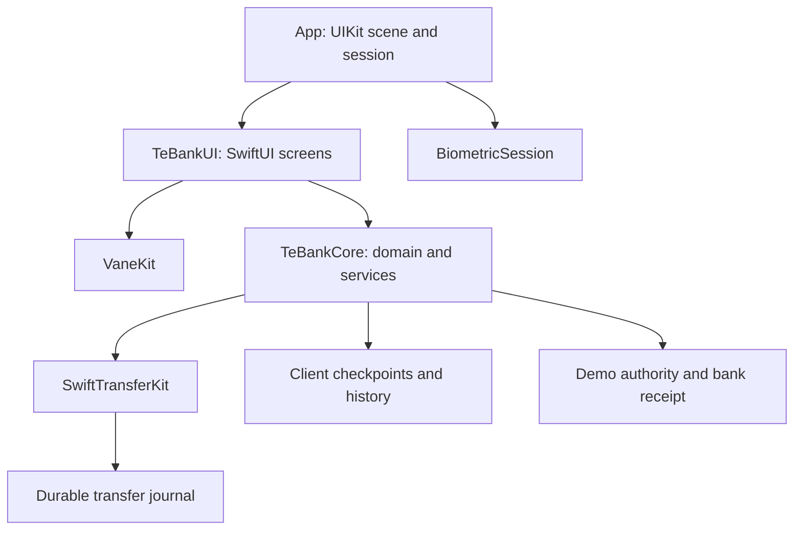

<div align="center">
  
  <h1>tebank</h1>
  <p>
    <a href="https://github.com/enjelhutasoit/TeBank/actions/workflows/ci.yml"></a>
    <a href="LICENSE"></a>
    
    
  </p>
  <p>An independent iOS business banking prototype demonstrating recoverable financial workflows, reusable Swift SDK integration and accessible SwiftUI interfaces with synthetic data.</p>
</div>

## What you can explore

| Workflow | Engineering focus |
| --- | --- |
| Device-authenticated session | BiometricSession integration, passcode fallback, scene privacy cover and relock |
| Business onboarding | Explicit consent, synthetic samples, persisted request identity and simulated authority decisions |
| Business dashboard | Synthetic balance, transaction details, accessible labels and light/dark design tokens |
| Payment links | Creation, sharing, expiry, simulated payment and idempotent retry |
| Local transfers | Review, validation, durable submission identity, lost-response reconciliation and relaunch recovery |
| Transfer history | Archived reviewed details and read-only status lookup using the original intent |

tebank is an unofficial demo. All balances, identities, transactions and bank responses are synthetic. It does not open accounts, collect identity photos or move money.

## Architecture



- [TeBankCore](Sources/TeBankCore) owns onboarding state, synthetic ledger, payment links, transfer validation and service adapters.
- [TeBankUI](Sources/TeBankUI) owns observable screen models, navigation, and VaneKit theme integration.
- [App](App) hosts SwiftUI in UIKit and owns window lifecycle, authentication and privacy shielding.

The app integrates [BiometricSession](https://github.com/enjelhutasoit/biometric-session-sdk), [VaneKit](https://github.com/enjelhutasoit/VaneKit) and [SwiftTransferKit](https://github.com/enjelhutasoit/SwiftTransferKit). The [package manifest](Package.swift) and [workspace lockfile](TeBank.xcodeproj/project.xcworkspace/xcshareddata/swiftpm/Package.resolved) record the dependency configuration.

Read the [transfer recovery ADR](docs/adr/001-transfer-recovery.md) and [onboarding persistence design](docs/onboarding-persistence.md) for ownership, failure handling and trade-offs.

## Run locally

1. Install Xcode 16.2 (build `16C5032a`) and an eligible iOS simulator.
2. Open `TeBank.xcodeproj`, select the shared `TeBank` scheme and an installed iPhone simulator.
3. Run the app, select **Login**, and authenticate using the simulator's enrolled biometric or device passcode.

The package uses Swift 6.0.3 with Xcode 16.2 and targets iOS 17+ and macOS 14+.

## Demo

Follow the [guided demo](docs/demo.md) to approve a synthetic business, inspect the dashboard, share a payment link, and recover a transfer after terminating the app.

## Verification

From the repository root with Xcode 16.2 selected:

```bash
git rev-parse HEAD
./verify.sh
```

For package tests alone:

```bash
xcrun swift test --disable-automatic-resolution -Xswiftc -warnings-as-errors
```

Hosted [CI](.github/workflows/ci.yml) determines verification scope on Linux and schedules independent package and iOS jobs on macOS 15. Package tests use Xcode 16.2, iOS verification uses Xcode 16.4. Markdown-only changes skip both macOS jobs. Core-only PRs run package tests and build the iOS shell, while full verification includes simulator UI tests.

- [Package tests](Tests/TeBankCoreTests) cover persistence, onboarding, payment links, transfer recovery, history, ledger and color contrast.
- [UI tests](Tests/TeBankUITests) cover approval, dashboard accessibility audits, payment sharing, transfer validation, reconciliation, history and relaunch recovery.
- [Release evidence](docs/releases) tracks verified milestones. The final v1.0 verification remains a separate release gate.

## Limitations

Payment links live in memory for the current app process and use synthetic URLs under `pay.tebank.invalid`. Local transfer checkpoints and journals persist across relaunch. Simulated bank acceptance represents acceptance for processing, and the dashboard balance stays synthetic. Recipient routing, real settlement, fees and bank-specific limits are outside the demo. Manual physical-device accessibility and performance profiling remain pending.

## License

[MIT](LICENSE)
